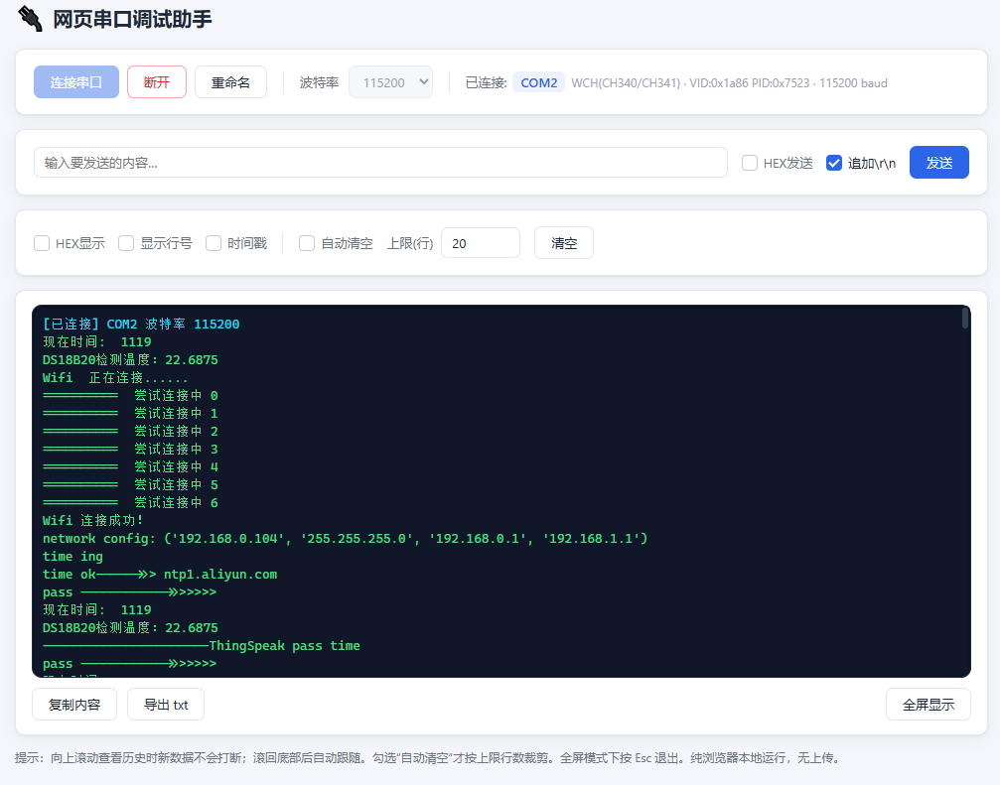

# 网页串口调试助手 (Web Serial Debug Assistant)

一个纯前端、零依赖的网页版串口调试助手，基于浏览器 **Web Serial API** 实现，打开网页即可连接本机串口收发数据，无需安装任何软件。

> ⚠️ 需要 Chrome / Edge 等 Chromium 内核浏览器（89+），且必须运行在 `https://` 或 `localhost` 下。

[示例页面 https://dsured.github.io/web-serial-port](https://dsured.github.io/web-serial-port/)



## ✨ 功能

- **串口连接**：选择串口、设置波特率（9600 ~ 921600），连接后锁定波特率
- **串口别名**：首次连接可给串口起别名（如 `COM3`），按 VID/PID + 授权索引持久化到 `localStorage`，下次自动套用
- **串口详情**：显示芯片型号（CH340、CP210x、FTDI、Arduino、Pico 等）、VID/PID、当前波特率
- **文本 / HEX 收发**：发送支持 HEX 模式与追加 `\r\n`；显示支持 HEX 模式
- **跨分片行缓冲**：兼容 `\r\n`、`\r`、`\n` 三种行结束符，解决串口分片导致的"有时两行有时一行"问题
- **智能滚动**：向上滚动查看历史时新数据不打断，滚回底部自动恢复跟随
- **自动清空**：可选按"上限(行)"裁剪旧日志，裁剪后行号自动连续重排
- **行号 / 时间戳**：可开关，格式 `[HH:MM:SS.mmm]`，时间戳在数据到达时记录
- **页面内全屏**：日志区最大化铺满视口，底部工具条保留，按 `Esc` 退出
- **复制 / 导出**：一键复制日志内容（不含行号、时间戳），导出为 `.txt`
- **热插拔提示**：设备插入 / 拔出自动提示，拔出当前设备时自动断开

## 🚀 快速开始

### 方式一：本地直接打开

由于 Web Serial 要求安全上下文，不能直接双击 `file://` 打开。任选一种本地服务器：

```bash
# Python 3
python -m http.server 8000

# Node.js
npx serve .

# VS Code
# 安装 Live Server 插件，右键 index.html -> Open with Live Server